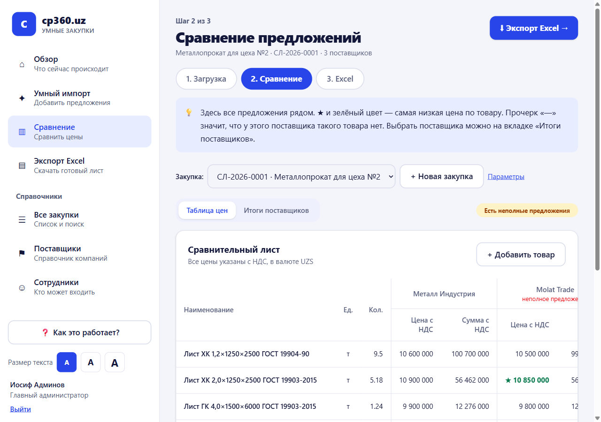
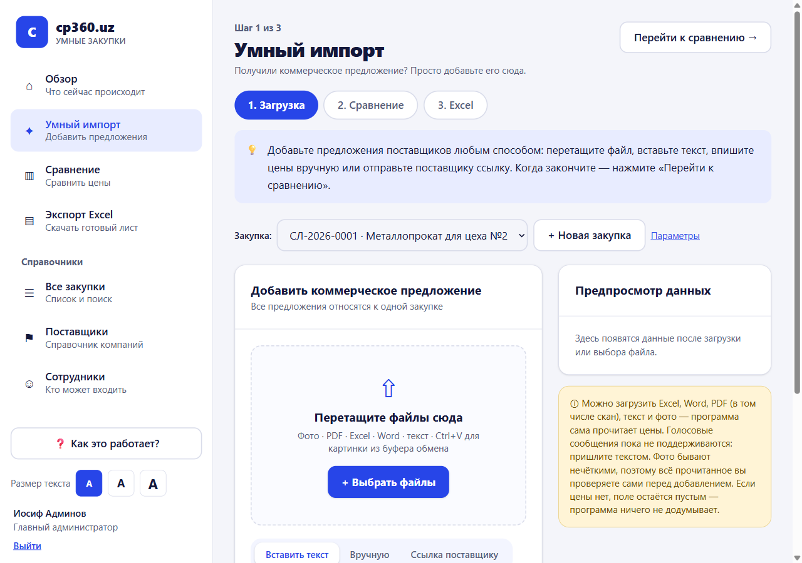
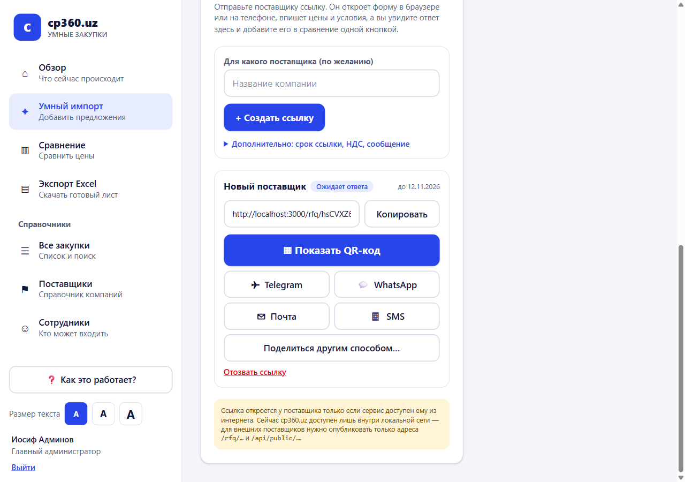
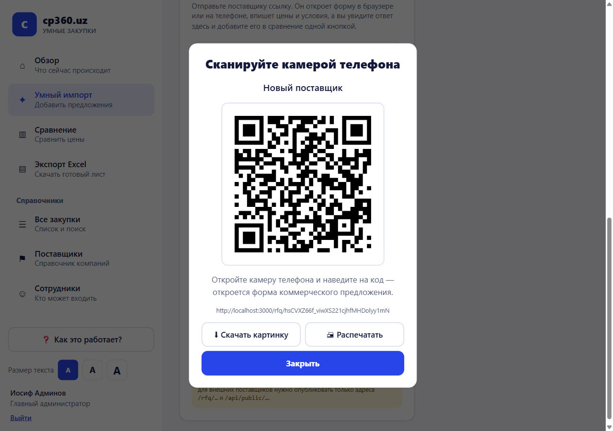
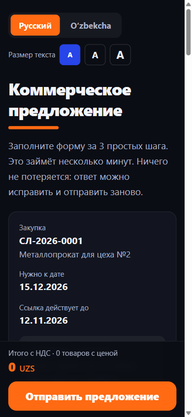
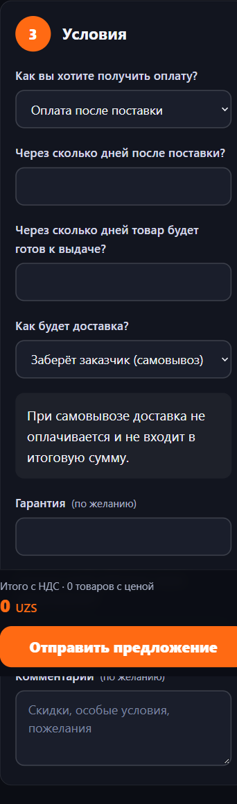
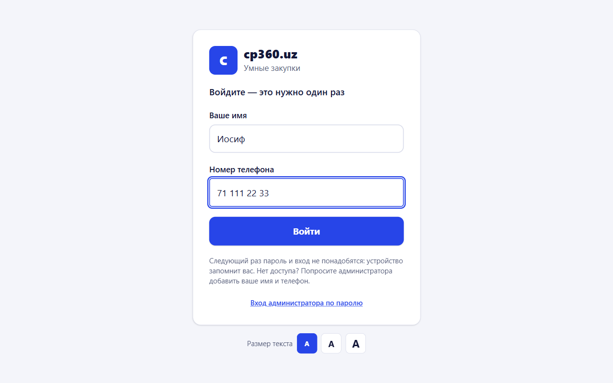
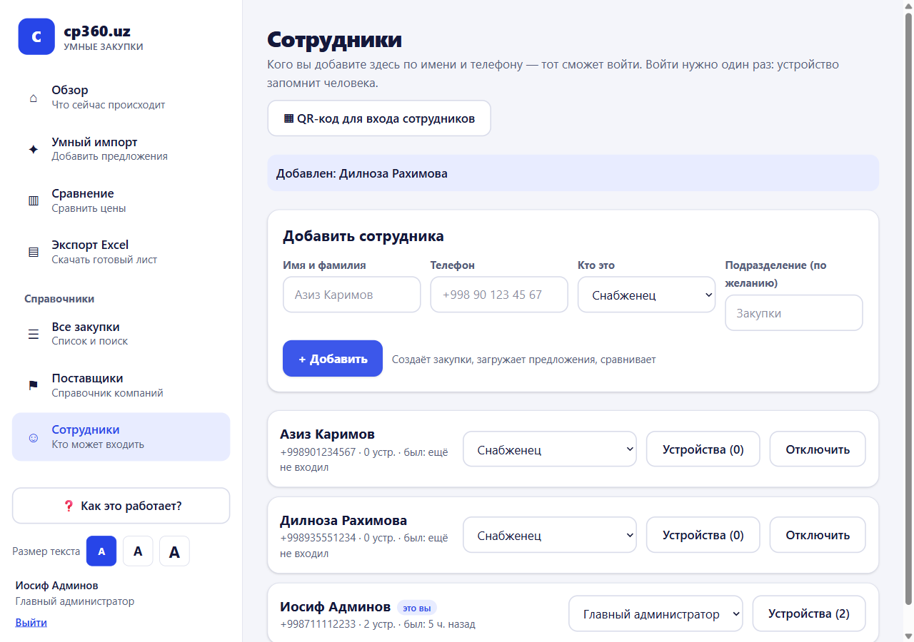
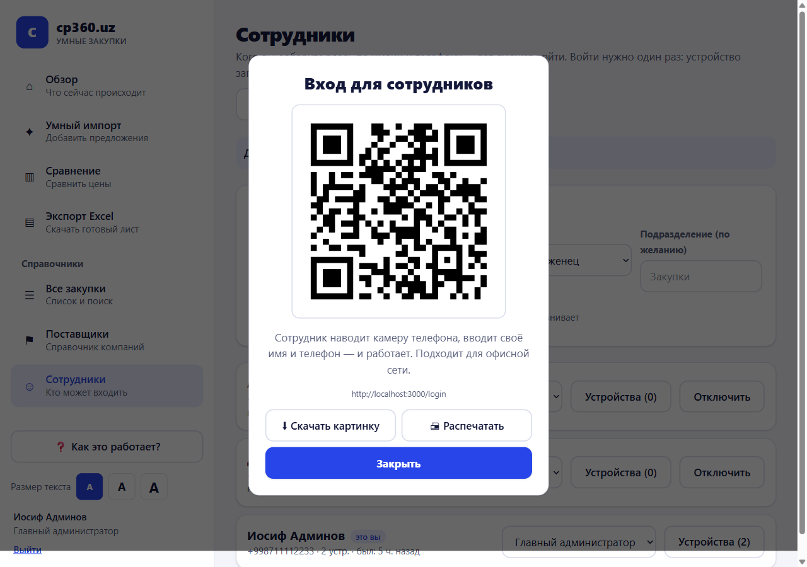

<div align="center">

# cp360.uz

**Умные закупки: от пачки разных коммерческих предложений до готового сравнительного листа Excel — за несколько нажатий.**


Работает **на вашем сервере (NAS)**: все данные, файлы и резервные копии остаются у вас.



</div>

---

## Что это и зачем

Поставщики присылают коммерческие предложения как попало: фото, PDF, Excel, переписка в Telegram. Сотрудник вручную переносит цены в таблицу Excel.
**cp360.uz делает это за него:**

1. **Добавьте предложения** — загрузите файл или фото, вставьте текст, впишите цены или **отправьте поставщику ссылку** (он заполнит форму на телефоне).
2. **Сравните** — все цены рядом, лучшая отмечена ★, неполные предложения не выдаются за лучшие.
3. **Скачайте Excel** — готовый сравнительный лист с рабочими формулами, подписями и печатью.

> Программа **ничего не придумывает**: если цены нет, поле остаётся пустым («—», а не ноль), а всё распознанное человек проверяет перед добавлением.

## Как это выглядит

| 1. Добавить предложения | 2. Сравнить цены |
|---|---|
|  |  |

### Ссылка для поставщика: QR, Telegram, WhatsApp, почта, SMS

Снабженец нажимает «Создать ссылку» и отправляет её любым способом. Поставщик открывает форму на телефоне, ничего не устанавливая и не регистрируясь, — а ответ сразу появляется у снабженца, и **одна кнопка «Добавить в сравнение»** вносит его в таблицу.

| Отправка ссылки | QR-код | Форма на телефоне | Самовывоз |
|---|---|---|---|
|  |  |  |  |

- Форма на **русском и узбекском** (переключатель), крупный текст, три шага, итог считается на лету.
- Выбрали **«Самовывоз»** — поле стоимости доставки исчезает, и доставка нигде не считается.
- Поставщик может предложить **аналог** — он попадёт на техническую проверку и не станет «лучшим» без вашего одобрения.

### Вход: имя и телефон, один раз

| Вход | Сотрудники | QR для входа |
|---|---|---|
|  |  |  |

- Администратор добавляет сотрудника (**имя + телефон**) — больше ничего не нужно. Паролей у снабженцев нет.
- **Из офиса** сотрудник входит сразу, и устройство **запоминает его на год**.
- **Из внешней сети** новое устройство ждёт **одного нажатия администратора** («Разрешить»).
- Администратор видит все устройства, может отключить человека — и все его устройства выйдут мгновенно.
- В меню «Сотрудники» есть **QR-код для входа**: наведите камеру — откроется сайт.

## Возможности

| Область | Что умеет |
|---|---|
| **Загрузка** | Excel, Word, PDF (в том числе **сканы**), текст, **фото** (OCR: русский, узбекский, английский), вставка из буфера, перетаскивание |
| **Распознавание** | Таблицы и строки вида «название, ед., кол-во, цена, сумма», проверка «количество × цена = сумма», исправление типичных ошибок OCR |
| **Проверка человеком** | Исходный текст слева, поля справа; предупреждения о сомнительных значениях; каждая правка сохраняется (было / стало / кто / когда) |
| **Сопоставление** | Предлагает соответствие товаров, но **не считает равными** товары с разными размерами, ГОСТ, маркой стали или единицами — отправляет на техническую проверку |
| **Сравнение** | Точные десятичные расчёты, НДС, валюты по явному курсу, самая низкая цена по позиции, самое дешёвое **полное** предложение, закупка у нескольких поставщиков, возможная экономия |
| **Excel** | Двухуровневая шапка, объединённые ячейки, формулы, итоги, подсветка лучшего, печать A4, 5 листов (лист, товары, КП, курсы, история) |
| **Согласование** | Черновик → проверка → согласование → утверждено / возвращено / отклонено, блокировка после утверждения, новые версии, журнал |
| **Доступ** | Роли, права по подразделениям, журнал действий, устройства и их отзыв |
| **Для всех возрастов** | Крупный шрифт («А А А»), подсказки на каждом шаге, понятные ошибки, светлая/тёмная тема, управление с клавиатуры |

## Быстрый старт

### Вариант 1. На сервере или NAS (Docker) — рекомендуется

```bash
git clone https://github.com/yusuf2205/cp360.uz.git
cd cp360.uz
cp .env.example .env        # откройте и заполните пароли, имя и телефон администратора
docker compose up -d --build
```

Сайт откроется на `http://<адрес-сервера>:3280`. Войдите по имени и телефону администратора из `.env`.

Что поднимается: **PostgreSQL**, **API** (FastAPI), **сайт** (Next.js), служба прав на папку файлов и контейнер **ежедневных резервных копий**.

### Вариант 2. Для разработки на своём компьютере

```bash
# сервер (SQLite, таблицы создаются сами)
cd backend
python -m venv .venv && .venv/Scripts/pip install -r requirements.txt     # Linux/Mac: .venv/bin/pip
uvicorn app.main:app --port 8000

# сайт (в другом окне)
cd frontend && npm install && npm run dev                                 # http://localhost:3000
```

Первый вход: `admin@example.com` / `admin12345` (ссылка «Вход администратора по паролю»). **Смените пароль.**
Демо-данные: `python scripts/demo_seed.py` создаст закупку с тремя поставщиками и ссылкой для поставщика.

## Установка на Ugreen NAS (DXP4800 Plus)

1. В приложении **Docker** на NAS (или по SSH) убедитесь, что доступна команда `docker compose`.
2. Скопируйте проект в папку, например `/volume1/docker/cp360` (git clone или загрузка архива).
3. `cp .env.example .env` и заполните: `POSTGRES_PASSWORD`, `SECRET_KEY`, `BOOTSTRAP_ADMIN_NAME`, `BOOTSTRAP_ADMIN_PHONE`, `BOOTSTRAP_ADMIN_EMAIL`, `BOOTSTRAP_ADMIN_PASSWORD`.
4. `docker compose up -d --build` (первая сборка скачивает пакеты — на медленном интернете это может занять время).
5. Откройте `http://<IP-NAS>:3280`, войдите, добавьте сотрудников в разделе **«Сотрудники»**.

**Где лежат данные** — всё на вашем NAS, в папке проекта:

| Что | Путь |
|---|---|
| База данных | `data/postgres` |
| Оригиналы файлов (КП, фото, сканы) | `data/storage` |
| Резервные копии (раз в сутки, хранятся 14 дней) | `data/backups` |

Копируйте `data/backups` на внешний диск или в другое место.

**Восстановление из копии:**
```bash
gunzip -c data/backups/db-<дата>.sql.gz | docker compose exec -T db psql -U procurementpro procurementpro
tar xzf data/backups/files-<дата>.tgz -C data/storage
```

## Ссылки для внешних поставщиков (по желанию)

Сервис работает **внутри вашей сети**. Чтобы поставщики вне офиса могли открывать форму, нужно опубликовать **только** эти адреса (например, через Cloudflare Tunnel → `http://frontend:3000`):

```
/rfq/*          форма поставщика
/_next/*        скрипты и стили страницы
/api/public/*   приём ответа
```

Всё остальное (вход сотрудников, закупки, файлы) наружу **не выставляйте**.
Сотрудникам вне офиса лучше работать через VPN (например, Tailscale), а при входе без VPN администратор подтверждает устройство.

## Безопасность

- **Вход:** только зарегистрированные имя + телефон; ограничение числа попыток; на вопрос «кто есть в системе» отвечает одинаково.
- **Устройства:** из офиса — сразу; снаружи — с разрешением администратора; «сеть офиса» определяется по всей цепочке адресов, подделать заголовок нельзя. Администраторы снаружи входят только по паролю.
- **Файлы:** тип проверяется по содержимому (исполняемые и скрипты отклоняются), ограничения размера и количества, оригиналы отдаются только после входа.
- **Ссылки поставщикам:** случайные, с истечением, можно отозвать; поставщик не видит ни других поставщиков, ни цен; его ответ попадает в сравнение **только после вашего нажатия**.
- **Excel:** текст поставщика никогда не выполняется как формула.
- **ИИ:** по умолчанию выключен — данные не покидают сервер. Текст документов всегда считается недоверенным.
- Журнал действий, блокировка утверждённых документов, права по ролям и подразделениям.

> Утверждение в программе — **не квалифицированная электронная подпись.**

## Настройки (`.env`)

| Переменная | Назначение |
|---|---|
| `POSTGRES_PASSWORD`, `SECRET_KEY` | Обязательные секреты |
| `BOOTSTRAP_ADMIN_NAME` / `_PHONE` | Главный администратор (вход по имени и телефону) |
| `BOOTSTRAP_ADMIN_EMAIL` / `_PASSWORD` | Запасной вход по паролю |
| `SESSION_DAYS` | Сколько дней устройство помнит вход (365) |
| `LAN_ONLY_INSTANT_LOGIN` | `true` — из офиса сразу, снаружи с разрешением |
| `TRUSTED_NETWORKS` | Дополнительные «свои» сети (например, VPN) |
| `OCR_LANGS` | Языки распознавания фото и сканов |
| `AI_MODE` | `off` / `local` / `external` — языковая модель для сложных текстов |
| `STT_URL` | Сервис распознавания речи для голосовых (необязательно) |

## Тесты

```bash
cd backend && python -m pytest tests -q        # 70 тестов
```

Покрыто: расчёты и НДС, сравнение и выбор поставщика, сопоставление товаров, разбор строк и OCR-текста, импорт файлов, согласование и блокировки, Excel (формулы, структура, защита от формул), вход по телефону и устройства, ссылки поставщиков, самовывоз и доставка.

## Структура проекта

```
backend/    FastAPI, модели, миграции (Alembic), разбор документов, расчёты, Excel, тесты
frontend/   Next.js 16 + Tailwind: сайт сотрудников и форма поставщика
scripts/    demo_seed.py — демонстрационные данные
docs/       скриншоты
docker-compose.yml, .env.example
```

## Ограничения (честно)

См. подробный отчёт в [STATUS.md](STATUS.md). Главное:

- **Голосовые сообщения** пока не распознаются (нужен отдельный сервис речи, `STT_URL`).
- **Свободный текст без таблицы** (длинная переписка) разбирается слабо без языковой модели (`AI_MODE=local`).
- **Загрузка вашего корпоративного шаблона Excel**, отчёты и аналитика, уведомления в Telegram, интеграция с КЭП — в планах.
- Перевод на узбекский пока только у формы поставщика и требует проверки носителем языка.

---

<div align="center">Сделано для отдела закупок · данные остаются у вас</div>
